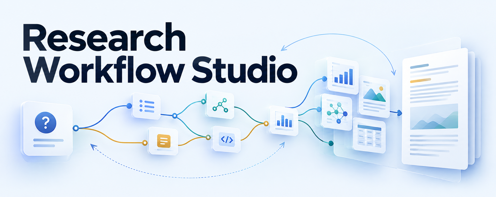
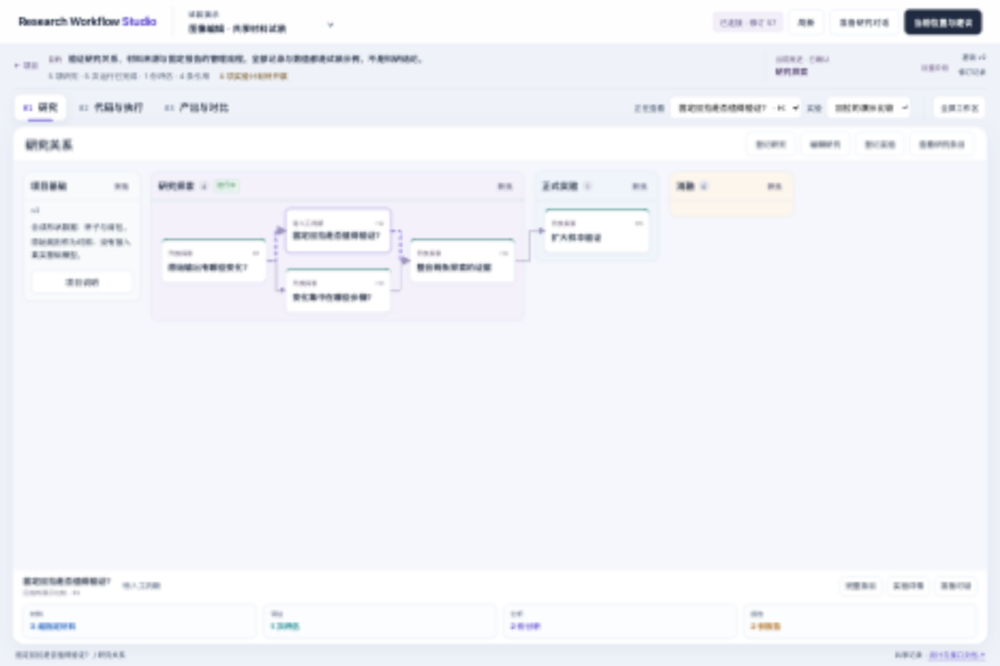
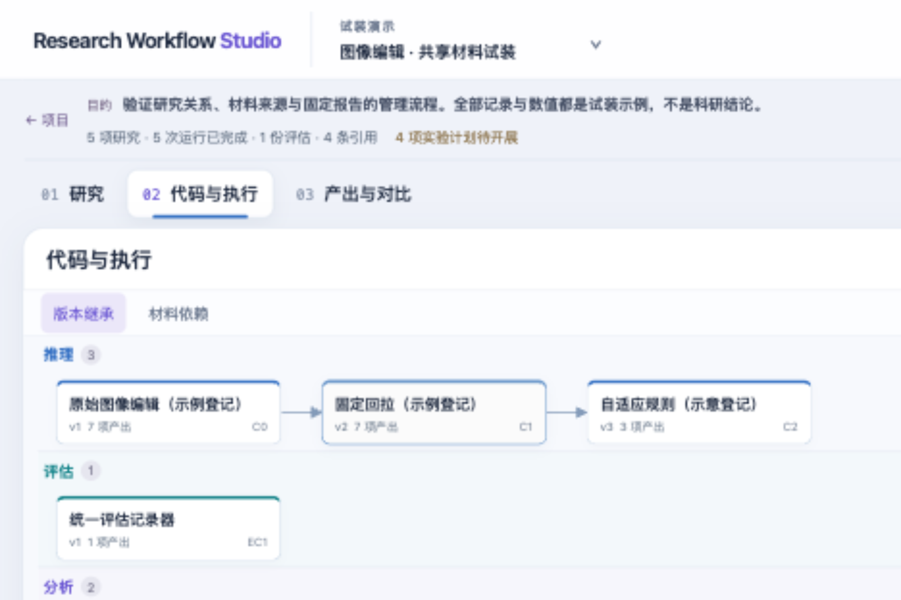
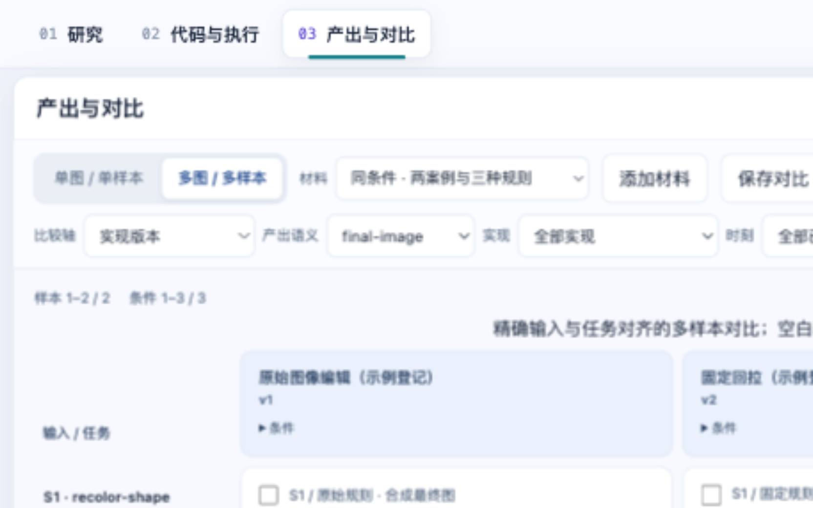

<p align="center">
  
</p>

# Research Workflow Studio

**A visual, human-guided research workflow — from questions to reusable code, evidence and reports.**

[简体中文](README.zh-CN.md) · [Quick start](#quick-start) · [MCP](#connect-your-ai-client) · [Development templates](templates/README.md) · [Data contract](CONTRACT.md)

Research rarely follows a straight line. You explore a question, inspect intermediate outputs, reuse a control, change a method and compare again. Research Workflow Studio keeps those relationships visible without treating every case as a new code version or every result as a new research claim.

It is a **local desktop web workbench with a Python backend, SQLite storage and an MCP server**. An AI client can create and read structured records through MCP; your development tools run the actual code. You decide the research direction, conclusions and project-level changes.

## One workspace, three views

| View | What it helps you do |
| --- | --- |
| **Research** | Read the project foundation, follow branching questions and hypotheses, see the current stage and reuse evidence. Exploration does not require an improvement hypothesis. |
| **Code & execution** | Define inputs and outputs before implementation; follow inference, evaluation, analysis and report code separately. Inspect actual execution provenance when needed. |
| **Outputs & comparison** | Compare one case across settings or align several cases across implementations. Filter output semantics and steps; keep missing cells and repeated candidates explicit. |

Saved comparisons are working selections. Analyses explain observations and their limits. Reports preserve the exact evidence and project context used at the time; new results do not rewrite old reports.

<details>
<summary>See the desktop workspace (synthetic demonstration)</summary>





</details>

## Quick start

Requires **Python 3.9+**. Runtime has no third-party Python or JavaScript dependencies. The UI is designed for desktop browsers; interface text is currently Chinese.

```sh
git clone https://github.com/BorgDiven/research-workflow-studio.git
cd research-workflow-studio
mkdir -p .local
python3 tools/seed_demo.py --db "$PWD/.local/demo.sqlite3"
python3 launch.py serve --db "$PWD/.local/demo.sqlite3" --port 8831
```

Open **http://127.0.0.1:8831**. The demo uses explicitly synthetic records and illustration assets; it does not run a model or measure image quality. Seeding refuses to overwrite existing demo projects.

For your own empty workspace, choose a different database path and skip the seed command:

```sh
python3 launch.py serve --db "$PWD/.local/my-research.sqlite3" --port 8831
```

Optional CLI installation in your Python virtual environment from this checkout: `python3 -m pip install .`, then `research-workflow-studio serve --db /absolute/path/studio.sqlite3`. Source-based development templates remain in this repository.

## Connect your AI client

MCP is the structured tool interface between an AI client and Studio. Configure a **stdio MCP server** using your actual absolute paths:

```json
{
  "mcpServers": {
    "research-workflow-studio": {
      "command": "python3",
      "args": [
        "/absolute/path/research-workflow-studio/launch.py", "mcp",
        "--db", "/absolute/path/studio.sqlite3",
        "--web-url", "http://127.0.0.1:8831"
      ]
    }
  }
}
```

The browser service and MCP process must use **the same database**. Adapt the configuration wrapper to your client, reconnect it and inspect its loaded tools. MCP configuration alone does not start the web server.

A useful first prompt:

> Open my project in Research Workflow Studio. Read its foundation and current research context. Tell me what is already recorded, what is missing and the next useful action. Before implementing a method, find reusable code and agree on a specification. Do not execute an experiment or approve a scientific decision without my instruction.

The model can create projects, questions, specifications, implementation records, execution records, artifacts, evidence references, evaluations, comparisons, analyses and reports. It can propose changes to project context and provenance. Human approval is separate. Studio provides **no shell, GPU launcher or arbitrary file-read MCP tool**.

## Build reusable research blocks

```sh
python3 tools/scaffold.py --kind inference --destination .local/my-method --title "My method"
python3 tools/check_block.py .local/my-method --output .local/check.json
```

The checker is static by default. Add `--execute` only when you intend to execute that block locally. The supplied templates use small standard-library synthetic fixtures, with no model downloads or GPU usage.

A specification declares purpose, input/output semantics, configurable values, dependencies and acceptance checks. A registered implementation pins a ready specification revision, repository, Git commit, module path, entrypoint and supplied check evidence. Cases and ordinary parameter changes belong in inputs/configuration. See [the four templates](templates/README.md) and [contributor rules](AGENTS.md).

## Data that stays understandable

- **Question ≠ implementation lineage.** A baseline can support several questions without changing its origin.
- **Artifact origin stays fixed.** Reusing an image in another experiment or project adds a reference, not a new producer.
- **An execution may cover several cases or settings.** Each artifact carries its actual configuration and output semantics. Execution details are available without another visible grouping layer.
- **Final output ≠ diagnostic output.** A predicted clean image, velocity field, curve and metric table can be compared as the corresponding kind of evidence.
- **Corrections are audited.** Approved amendments preserve the original record; previously frozen reports retain their original snapshot.
- **A completed run ≠ a supported hypothesis.** Scientific judgments and project-foundation changes remain human decisions.

## Private remote use

The service binds to loopback. It supports an explicitly configured **Tailscale Serve** proxy for private cross-device use; see [deployment](docs/deployment.md). Real projects, SQLite files and managed materials stay on your server. This public repository contains software and synthetic examples, not a public hosted workspace.

## Development and status

Version **0.3.0** is an early, single-user workbench. It has no collaborative multi-user permissions, cloud synchronization, automatic experiment scheduler or mobile layout. Supplied check evidence is recorded, not independently certified. Review changes and keep a database backup when upgrading.

```sh
python3 -m unittest discover -s tests
node --test web/tests/*.test.js
```

See [architecture](docs/architecture.md), [roadmap](docs/roadmap.md) and [contributing](CONTRIBUTING.md). Issues describing a concrete workflow are welcome.

MIT licensed. The title illustration and demo contact sheet are AI-generated branding/illustration assets, not experimental evidence; [asset provenance](docs/assets/banner-prompt.md).
