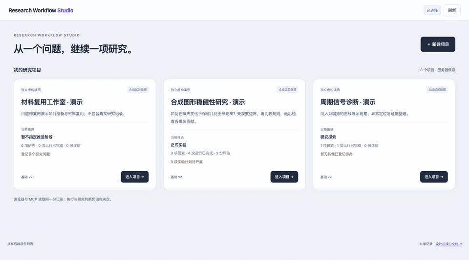
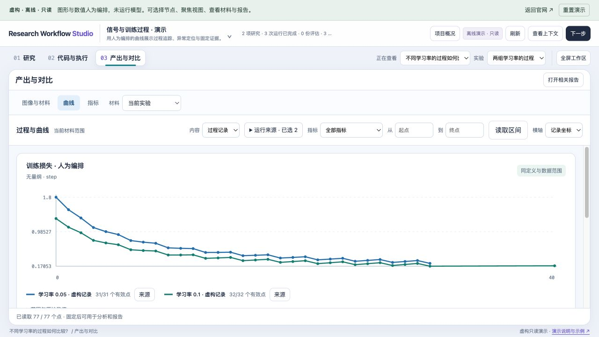

# Research Workflow Studio


**由人掌握方向、AI 协助记录与推进的研究工作流：把问题、代码、证据和报告连接起来。**

[官网与在线体验](https://borgdiven.github.io/research-workflow-studio/) · [English website](https://borgdiven.github.io/research-workflow-studio/en/) · [代码模板](templates/README.md) · [数据约定](CONTRACT.md)

它是一个本地网页工作台，配套 Python 后端、SQLite 数据库和 MCP 服务。MCP 是模型读写工作台记录的接口：模型可以创建项目和研究节点、读取上下文、登记实现与材料、整理评估和报告；实际写代码使用开发工具；Git 和任务操作可交给显式调用的命令行执行器。研究判断、项目基础修改和来源纠正由人决定。

## 开始使用

需要 Python 3.9+，运行时没有第三方依赖；界面面向电脑端，当前使用中文。

```sh
git clone https://github.com/BorgDiven/research-workflow-studio.git
cd research-workflow-studio
mkdir -p .local
python3 tools/seed_showcase.py --db "$PWD/.local/showcase.sqlite3"
python3 launch.py serve --db "$PWD/.local/showcase.sqlite3" --port 8831
```

打开 http://127.0.0.1:8831。演示包含虚构项目主页、分叉研究树、代码角色、几何图形、曲线与固定报告。可重复导入，拒绝向含其他项目的数据库写入；不运行模型、不代表科研结论。建立自己的空工作台时，换一个数据库文件并省略 `seed_showcase.py`。

## 三个视图，共用同一份记录

- **研究**：先读项目基础，再看问题、假设、探索和阶段；小实验也可以只为寻找 insight。
- **代码与执行**：训练、推理、评估、分析、报告分别展示。先定义代码块的输入输出和验收规则，再编写可复用实现；不同案例和参数不另造代码版本。
- **产出与对比**：按材料切换图像、曲线和指标布局；图像可按案例对齐，曲线只叠加口径兼容的数据。缺图留空、缺失值不补零，过程数据冻结后再用于分析和报告。

对比集合用于探索；分析说明观察、解释、范围和限制；报告固定当时选中的证据和项目基础。相同材料可以被多个研究或报告引用，来源不变。

以下动图和桌面预览展示 0.3 版本界面，使用独立的虚构项目、程序生成的几何图形及人为设定的示例指标，不含真实研究数据。

[观看完整操作演示](https://github.com/BorgDiven/research-workflow-studio/releases/download/v0.3.3/workspace-tour.mp4)



**研究**


**代码与执行**


**产出与对比**


## 接入 AI

在支持 stdio MCP 的客户端中配置 `python3 /绝对路径/research-workflow-studio/launch.py mcp --db /绝对路径/studio.sqlite3 --web-url http://127.0.0.1:8831`。网页和 MCP 必须指向同一数据库，客户端需要重新连接。完整配置见 [英文 README](README.md#connect-your-ai-client)。

可以这样开场：

> 进入我的项目，读取项目基础和当前节点，说明已经完成什么、缺少什么、下一步建议做什么。写代码前先找可复用实现，并建立输入输出规则。实际执行和科研决策按我的指令进行。

当前提供 37 个 MCP 工具，覆盖研究记录、过程指标、资源登记和操作提议。登记运行、提出请求、人工确认和实际执行是分开的：模型可以提出具体 Git 或任务请求；启动、停止、提交、推送等修改需要你确认，再由显式调用的 CLI 执行器处理。只读检查可直接等待执行器领取。MCP 没有任意 shell 或任意文件读取接口，模型不能自批请求。

研究详情中的“关联代码”可定位实现，代码详情中的“用于哪些研究”可返回问题。编辑研究时，可以先关联代码规范或已有实现，标明研究实现、对照或诊断用途；不必先生成一次运行。计划用途、实际使用和证据复用分别显示，同一份代码和产物可以服务多个研究。[字段与 MCP 写入示例](docs/contract-v3.md#declare-which-research-the-implementation-serves)

## 记录训练过程，按需固化证据



先在代码规范中声明指标的名称、单位、横轴、统计范围及协议，再从脚本批量上报。每一步不需要调用模型，也不会生成一张新卡片。曲线保留原值；不同口径分开显示。选定指标和区间后保存为固定材料，后续新增数据不会改写旧报告。

`tools/track_metrics.py` 支持 JSONL、断线待发队列，以及明确指定地址、run ID 和字段映射的 MLflow HTTP 历史导入。后者只用于 run 范围指标，声明的 split 用 `--mlflow-split` 指定；样本级数据用 JSONL 提供 sampleId。它不安装、不自动发现或接管 MLflow，也不根据导入完成推断训练成功。[使用步骤](docs/usage-guide.md) · [格式与示例](docs/format-guide.md)

## 从计划到执行，中间保留你的确认

在项目的“仓库与运行环境”里登记已有服务器、仓库和环境。运行计划固定代码 commit、仓库和环境；查看具体操作参数后确认，再复制页面给出的命令到工作台服务器终端。例如：

```sh
python3 launch.py operate --db /absolute/path/studio.sqlite3 \
  --project-id example-project --operation-id operation-example --version 2
```

上述标识是虚构占位，请使用实际请求的精确版本。这条命令会执行操作。启动结果未知时不会自动重跑；任务状态、日志和退出码与研究结论分开。SSH 传输目前仅做模拟验收，真实服务器接入需另行检查。执行器和记录客户端面向 macOS/Linux 等 POSIX 系统。

## 开发和使用边界

五类可复用模板见 [templates](templates/README.md)。代码实现绑定规则版本、Git commit、入口及检查证据；案例、指令、普通参数放在外部输入中。检查器默认只做静态检查，`--execute` 才会实际执行本地代码。

当前是 0.4.0 单用户早期版本，没有多用户协作权限、自动实验调度或手机布局。可以通过 [Tailscale 私有访问](docs/deployment.md) 跨电脑使用；公开仓库不包含真实研究数据库和材料。历史来源纠正保留原记录，旧报告不会被新数据改写。

[使用指南](docs/usage-guide.md) · [更新记录](CHANGELOG.md) · [数据约定](CONTRACT.md) · [架构](docs/architecture.md) · [后续方向](docs/roadmap.md) · [贡献](CONTRIBUTING.md)
