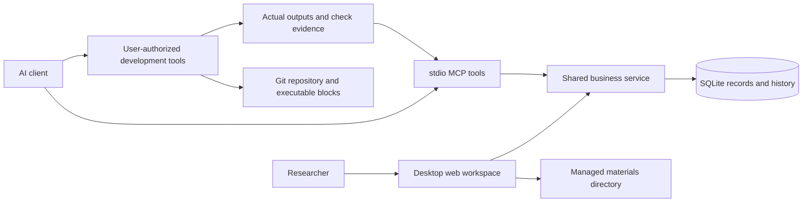

# How the pieces fit

The browser and MCP use the same business service and explicit database path. Every write is revision-checked and idempotent. The browser displays committed data; browser drafts are not a second database. MCP has model authority and cannot approve human-only changes.

A project foundation captures purpose, baseline, approach, resources and confirmed context. Questions and hypotheses reference it through experiments. Experiments record an intent; implementation records identify reusable code; execution records identify what actually ran. Individual artifacts carry cases, configuration and semantics. Usage records connect evidence to a question without moving its origin.

A specification precedes implementation. It defines the interface that code is written to satisfy. Implementation registration pins the specification revision and exact source identity. The service validates structure and supplied evidence, but does not inspect arbitrary repositories or run programs.

Research owns optional purpose links to exact specification/code revisions. A declared purpose is neither a producer relation nor an execution fact. The UI derives bidirectional navigation from those declarations, actual experiment executions, and active evidence usages; every artifact retains its original producer. Linked draft specifications support planning before an implementation exists. Research type, execution state and scientific judgment occupy separate display fields.

Comparison selections are independent of production records. A saved view pins selected artifacts and comparison dimensions. Analyses state scope and limitations. Reports pin the complete referenced closure and the relevant foundation versions. Later results, revisions or audited corrections do not mutate an existing report.

Managed material URLs serve only files under the `materials/` directory next to the database. Source paths in metadata do not grant arbitrary file access. Private imports are separate adapters: enumerate and review sources, preserve unknowns, copy only authorized materials, and use normal service operations.
